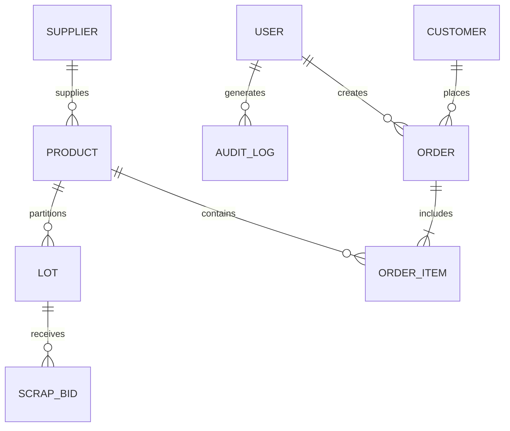

# StockLine Database Schema & Model Reference

StockLine uses MongoDB with Mongoose ODM for flexible document modeling, strong schema validation, and fast indexing.

---

## 1. Entity Relationship Diagram (ERD)

---

## 2. Collections & Schemas

### 2.1 User (`users`)
- `name` (String, required)
- `email` (String, required, unique, indexed)
- `password` (String, hashed with bcrypt 10 rounds)
- `role` (Enum: `admin`, `manager`, `staff`, default: `staff`)
- `status` (Enum: `active`, `suspended`, default: `active`)
- `createdAt`, `updatedAt` (Timestamps)

### 2.2 Product (`products`)
- `name` (String, required, trim)
- `sku` (String, required, unique, uppercase, indexed)
- `barcode` (String, indexed)
- `category` (String, required, indexed)
- `supplierId` (ObjectId, ref: `Supplier`)
- `price` (Number, required, min: 0)
- `costPrice` (Number, required, min: 0)
- `stock` (Number, default: 0)
- `reorderLevel` (Number, default: 10)
- `unit` (String, default: `pcs`)

### 2.3 Lot (`lots`)
- `lotNumber` (String, required, unique, indexed)
- `productId` (ObjectId, ref: `Product`, required)
- `quantity` (Number, required, min: 0)
- `manufactureDate` (Date)
- `expiryDate` (Date, indexed)
- `warehouseBay` (String, e.g. `Bay-A-04`)
- `isScrapDevalued` (Boolean, default: false)
- `bids` (Array of sub-documents: `{ bidder, amount, timestamp, status }`)

### 2.4 Order (`orders`)
- `orderNumber` (String, required, unique, indexed)
- `customerId` (ObjectId, ref: `Customer`)
- `items` (Array of items: `{ productId, quantity, unitPrice, subtotal }`)
- `totalAmount` (Number, required)
- `paymentStatus` (Enum: `Pending`, `Paid`, `Partial`, `Refunded`)
- `fulfillmentStatus` (Enum: `Pending`, `Processing`, `Delivered`, `Cancelled`)

---

## 3. Database Indexes

| Collection | Indexed Field(s) | Index Type | Purpose |
|------------|------------------|------------|---------|
| `users` | `email` | Unique | Fast credential lookup & login uniqueness |
| `products` | `sku` | Unique | Prevent duplicate product codes |
| `products` | `barcode` | Sparse | Rapid optical barcode scanner resolution |
| `lots` | `{ lotNumber: 1, productId: 1 }` | Compound | Fast batch inventory reconciliation |
| `orders` | `orderNumber` | Unique | Instant receipt and invoice lookups |
| `audit_logs`| `timestamp` | Descending | Chronological event stream rendering |
